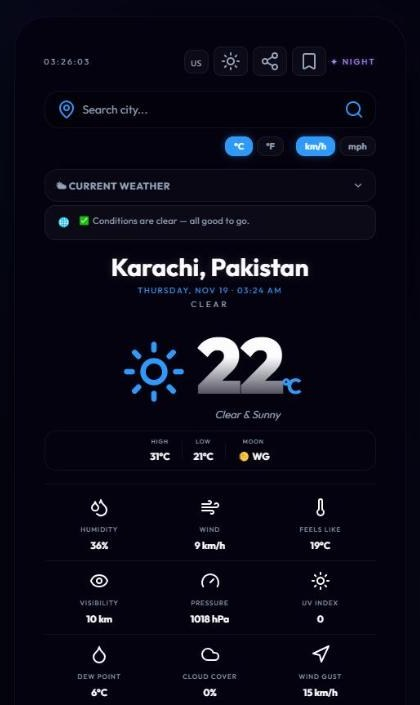

<div align="center">

# Aura Ethereal

**A detailed, multilingual weather app that runs in the browser and on Android.**

[](https://connectabdullahdev.github.io/weather-app/)




</div>

## What it does

Search any city, or let the app detect your location, and get far more than a temperature:

- **Current conditions:** humidity, wind and gusts, feels-like vs. real temperature, visibility, pressure, UV index, dew point and cloud cover
- **Forecasts:** hourly forecast, a 7-day forecast with a weekly trend chart, and a precipitation timeline
- **Air quality** with a plain-language rating
- **Live weather map** powered by Windy
- **Smart section:** a comfort index, a weather score, an outdoor planner with the best activities for the day, and what to carry
- **Sun and moon:** sunrise, sunset, daylight length and moon phase
- **Compare cities** side by side and browse world cities
- **Five languages:** English, Urdu, Spanish, Hindi and German
- °C / °F and km/h / mph toggles, day and night themes, share and bookmark, pull to refresh

## Tech stack

| Area | Tools |
| --- | --- |
| UI | HTML5, CSS3, vanilla JavaScript |
| Data | [WeatherAPI.com](https://www.weatherapi.com/) (current, forecast, air quality, astronomy) |
| Map | Windy embed |
| Charts and icons | Chart.js, Lucide |
| Mobile | Capacitor (Android build) |

## Run it locally

No build step is needed.

```bash
git clone https://github.com/connectabdullahdev/weather-app.git
cd weather-app
npx serve .        # or open index.html directly
```

The app calls WeatherAPI.com. To use your own key, replace the `KEY` value near the top of `script.js` with a free key from [weatherapi.com](https://www.weatherapi.com/).

## Project structure

```
weather-app/
├── index.html   # layout and all sections, with data-i18n labels
├── style.css    # themes, layout and animations
├── script.js    # API calls, rendering, charts, i18n and settings
└── docs/        # screenshots
```

---

<div align="center">

Built by **Muhammad Abdullah** · [LinkedIn](https://www.linkedin.com/in/connectabdullahdev) · [GitHub](https://github.com/connectabdullahdev)

</div>
